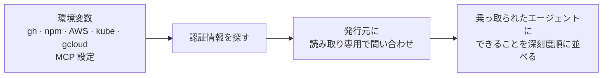

# howbad

[English](README.md) | **日本語**

[](https://github.com/kanywst/howbad/actions/workflows/ci.yml)
[](https://pkg.go.dev/github.com/kanywst/howbad)
[](LICENSE)

いまこのマシンのコーディングエージェントが prompt injection を食らったら、どこまで被害が出るか。


Claude Code も Codex も Cursor も、あなたのユーザー権限で動きます。シェルから届くものは、乗っ取られたエージェントからも届きます。キーチェーンにある `gh` のトークン、パッケージを publish できる npm トークン、朝ログインした AWS プロファイル、MCP の設定に貼った Slack トークン。`howbad` はそうした認証情報を探し、それぞれの発行元に「実際に何ができるか」を問い合わせます。

## インストール

```bash
brew install kanywst/tap/howbad
```

```bash
go install github.com/kanywst/howbad@latest
```

macOS と Linux のビルド済みバイナリは [Releases](https://github.com/kanywst/howbad/releases) にあります。SBOM と cosign の署名付きです。

## 使い方

```bash
howbad              # レポート
howbad -v           # 深刻度の低いものと、確認できなかった認証情報も表示
howbad --offline    # 探すだけで通信しない
howbad --json       # 機械可読な出力
howbad --fail-on high   # high 以上に届くものがあれば exit 2
```

## 仕組み



1. **探す。** あなたの権限で動くプロセスが認証情報を拾える場所をすべて見ます。
2. **問い合わせる。** 認証情報は、それを発行したプロバイダにだけ送ります。使うのは読み取り専用のエンドポイントだけです(`GET /user`、`whoami`、`sts:GetCallerIdentity`、Google Cloud の `testIamPermissions`、Kubernetes の `SelfSubjectAccessReview`)。
3. **並べる。** 結果を「49 リポに push でき、CI のワークフローも書き換えられる」のような具体的な文にして、深刻度順に出します。

## 確認する対象

| 認証情報 | 探す場所 | わかること |
| --- | --- | --- |
| GitHub | `gh` CLI(hosts.yml またはキーチェーン)、`$GITHUB_TOKEN`、MCP 設定 | push できるリポ、CI ワークフローの変更可否、org のオーナー権限、gist |
| npm | `~/.npmrc`、`./.npmrc`、`$NPM_TOKEN`、MCP 設定 | メンテしているパッケージと週間ダウンロード数 |
| Slack | MCP 設定、環境変数 | メッセージ履歴、検索、あなたとしての投稿 |
| AWS | `~/.aws/config`、`~/.aws/credentials`、環境変数、MCP 設定 | ID、アカウント、アタッチされたポリシー(または SSO の permission set) |
| Kubernetes | kubeconfig | コンテキストごとの cluster-admin、Secret、exec、Pod 作成 |
| GitLab | `$GITLAB_TOKEN` などの環境変数、MCP 設定(ホストは `GITLAB_HOST` / `GITLAB_API_URL` から) | トークンの scope: push、CI/CD、レジストリ、Runner、Kubernetes agent、管理者権限 |
| Google Cloud | gcloud の設定、Application Default Credentials、`$GOOGLE_APPLICATION_CREDENTIALS` | プロジェクトごと: IAM 管理、サービスアカウントのなりすまし、Secret Manager、GKE の認証情報、コード実行、データの読み取り・削除 |
| Stripe、OpenAI、Anthropic、Google API キー、Hugging Face、データベース URL | 環境変数、MCP 設定 | 形式で判別するだけで、問い合わせはしない |

読むエージェント設定は Claude Code、Codex、Cursor、Gemini CLI、Antigravity、VS Code、GitHub Copilot、Cline、Windsurf、Devin Desktop、Claude Desktop です。確認なしで動く設定のエージェント(user か managed settings にある Claude Code の `bypassPermissions`。同じ場所に `disableBypassPermissionsMode` があれば除外。Codex の `danger-full-access`)もレポートで目立たせます。Claude Code の managed settings と `managed-mcp.json` も読みます。

## 安全性

`howbad` は本物の認証情報を扱うので、扱い方は徹底して地味にしています。

- 秘密情報は表示しません。2 つのトークンを見分けられるよう、SHA-256 の先頭 8 桁だけ出します。
- 各認証情報の発行元以外には何も送りません。テレメトリもありません。
- 呼び出しはすべて読み取り専用です。唯一の書き込みは Kubernetes の self-review オブジェクトで、これは何も保存しません。Google のリフレッシュトークンとサービスアカウント鍵は、最初に短命のアクセストークンへ交換します。この交換は Google の監査ログに残ります。
- `--offline` では一切通信しません。`--no-exec` ではヘルパーを起動するもの(`gh auth token`、`gcloud auth print-access-token`、AWS の `credential_process`、kubeconfig の exec プラグイン)をすべて飛ばします。

詳細と脆弱性の報告方法は [SECURITY.md](SECURITY.md) を見てください。

## 制限

- fine-grained な GitHub トークン、GitHub App のトークン、npm のトークンは、自分の権限を返しません。これらはアカウント側の権限を上限として表示し、`inferred` と付けます。npm の publish には、2FA を回避する設定で作ったトークンでない限り 2FA も要りますが、レジストリはその設定を公開していません。
- AWS の権限はアタッチされたポリシー名から判断します。カスタムポリシーの中身は評価しません。自分のポリシーを読めないロールは、ロール名から推測します。
- Google Cloud の権限は、認証情報から一覧できる各プロジェクト(最大 25 件)に `testIamPermissions` を投げて調べます。フォルダ・組織・グループから継承した role も数に入ります。Workload Identity 連携(`external_account`)となりすまし設定はトークン交換せず、推測の上限として表示します。
- OAuth を使うリモート MCP サーバーのトークンは、エージェント自身の保存先(多くは OS のキーチェーン)にあり、`howbad` は読みません。
- カレントディレクトリの設定(`.mcp.json`、`.npmrc`、`.vscode/mcp.json` など)も読みますが、clone したリポに howbad を操られないようにしています。リポの `.npmrc` にある `${VAR}` は展開しませんし、接続先ホストまでリポの設定から来ているトークンはどこにも送りません。

## ライセンス

[Apache-2.0](LICENSE)
