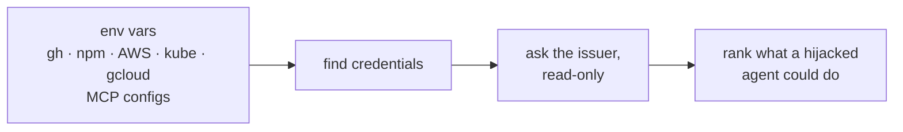

# howbad

**English** | [日本語](README.ja.md)

[](https://github.com/kanywst/howbad/actions/workflows/ci.yml)
[](https://pkg.go.dev/github.com/kanywst/howbad)
[](LICENSE)

If a coding agent on your machine got prompt-injected right now, how bad would it be?


Claude Code, Codex and Cursor run as you. Whatever your shell can reach, a hijacked agent can reach: the `gh` token in your keychain, the npm token that publishes your packages, the AWS profile you logged into this morning, the Slack token you pasted into an MCP config. `howbad` finds those credentials and asks each provider what they can actually do.

## Install

```bash
brew install kanywst/tap/howbad
```

```bash
go install github.com/kanywst/howbad@latest
```

Prebuilt binaries for macOS and Linux are on the [releases page](https://github.com/kanywst/howbad/releases), with SBOMs and cosign signatures.

## Use

```bash
howbad              # the report
howbad -v           # also low-severity reach and credentials that could not be checked
howbad --offline    # find credentials, make no network calls
howbad --json       # machine-readable
howbad --fail-on high   # exit 2 if anything high or critical is reachable
```

## How it works



1. **Find.** Every place a process running as you can pick up a credential.
2. **Ask.** Each credential is sent only to the provider that issued it, through read-only endpoints (`GET /user`, `whoami`, `sts:GetCallerIdentity`, Kubernetes `SelfSubjectAccessReview`).
3. **Rank.** Results become plain capabilities ("push code to 49 repos and rewrite their CI workflows") sorted by severity.

## What it checks

| Credential | Found in | Resolved to |
| --- | --- | --- |
| GitHub | `gh` CLI (hosts.yml or keychain), `$GITHUB_TOKEN`, MCP configs | repos you can push to, CI workflow access, org ownership, gists |
| npm | `~/.npmrc`, `./.npmrc`, `$NPM_TOKEN`, MCP configs | packages you maintain and their weekly downloads |
| Slack | MCP configs, env | message history, search, posting as you |
| AWS | `~/.aws/config`, `~/.aws/credentials`, env, MCP configs | identity, account, attached policies (or the SSO permission set) |
| Kubernetes | kubeconfig | cluster-admin, Secrets, exec, pod creation per context |
| Google Cloud | gcloud config, Application Default Credentials, `$GOOGLE_APPLICATION_CREDENTIALS` | account and project (roles not yet) |
| Stripe, OpenAI, Anthropic, Google API keys, GitLab, Hugging Face, database URLs | env, MCP configs | recognized by format, not called |

Agent configs read: Claude Code, Codex, Cursor, Gemini CLI, VS Code, Windsurf, Devin Desktop and Claude Desktop. The report also flags agents set to run without asking (Claude Code `bypassPermissions`, Codex `danger-full-access`).

## Safety

`howbad` handles your live credentials, so it is built to be boring with them.

- Secrets are never printed. Output shows a short SHA-256 fingerprint so you can tell two tokens apart.
- Nothing is sent anywhere except the provider that issued each credential. There is no telemetry.
- Every call is read-only. The only writes are Kubernetes self-review objects, which store nothing.
- `--offline` makes no network calls at all. `--no-exec` skips anything that would run a helper (`gh auth token`, AWS `credential_process`, kubeconfig exec plugins).

Read [SECURITY.md](SECURITY.md) for the details and how to report a problem.

## Limits

- Fine-grained GitHub tokens, GitHub App tokens and npm tokens cannot report their own permissions. For those, `howbad` shows the account's access as an upper bound and marks it `inferred`. npm publishing also needs 2FA unless the token was created to bypass it, which the registry does not expose.
- AWS permissions come from attached policy names. Custom policies are not evaluated, and a role that cannot read its own policies falls back to its name.
- Remote MCP servers that use OAuth keep their tokens in the agent's own store (often the OS keychain), which `howbad` does not read.
- Configs inside the current directory (`.mcp.json`, `.npmrc`, `.vscode/mcp.json`, ...) are read, but a cloned repo cannot steer howbad: `${VAR}` in a repo's `.npmrc` is not expanded, and a token whose host also comes from a repo config is not sent anywhere.

## License

[Apache-2.0](LICENSE)
